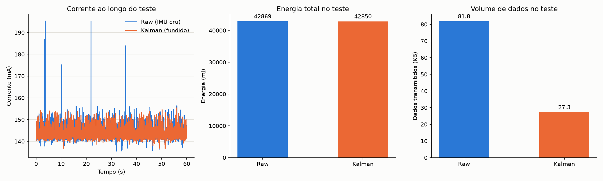
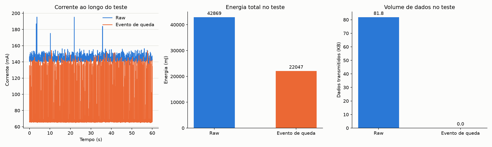
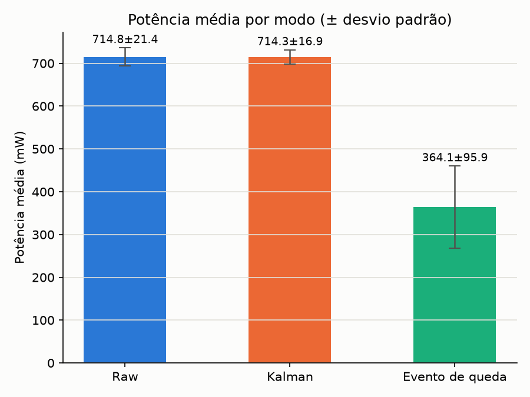

# residencia-experimentos

Experimentos práticos da residência: fusão de sensores em hardware real (ESP32 + IMU + sensores de distância), comparando Edge AI e fusão tardia.

## Pastas

- **`esp/`** — firmware do ESP32, em PlatformIO.
- **`fritzing/`** — diagramas de fiação do kit de sensores (`.fzz`, com o esboço de código `.ino` e a imagem de montagem acima).
- **`viz/`** — ferramenta simples de visualização das leituras dos sensores em tempo real.
- **`_archive/`** — versões anteriores/descartadas de ferramentas, fora do controle de versão.

## Experimento: fusão de dados (Kalman) vs. processamento de borda (evento) no consumo de energia

Testes práticos num nó ESP32 com IMU (MPU6050) e medição de corrente/potência via INA219,
comparando diferentes formas de processar e transmitir os dados antes de decidir sobre
otimização energética.

### Teste inicial: dado bruto vs. fusão por filtro de Kalman

Comparação entre transmitir o dado bruto do IMU via rede (UDP) a cada leitura, e transmitir o
resultado de um filtro de Kalman aplicado a esse mesmo dado (fusão acelerômetro+giroscópio em
ângulo de pitch/roll) antes de enviar.

**Modelagem do filtro.** Um filtro de Kalman escalar roda por eixo (pitch e roll, independentes),
com vetor de estado composto pelo ângulo e pelo bias do giroscópio:

$$x = \begin{bmatrix} \theta \\ b \end{bmatrix}$$

Predição (a cada passo, com $\dot\theta$ = taxa do giroscópio no eixo e $dt$ o intervalo entre
leituras):

$$\theta_k = \theta_{k-1} + (\dot\theta - b_{k-1}) \, dt$$

$$P_k^- = F P_{k-1} F^\top + Q, \quad F = \begin{bmatrix} 1 & -dt \\ 0 & 1 \end{bmatrix}, \quad Q = \begin{bmatrix} Q_{angle} & 0 \\ 0 & Q_{bias} \end{bmatrix}$$

Atualização, usando como medida $z$ o ângulo estimado por acelerômetro ($\mathrm{atan2}$ dos
eixos de aceleração), com ruído de medida $R$:

$$K = P_k^- H^\top (H P_k^- H^\top + R)^{-1}, \quad H = \begin{bmatrix} 1 & 0 \end{bmatrix}$$

$$x_k = x_k^- + K(z - H x_k^-), \qquad P_k = (I - K H) P_k^-$$

Os ganhos usados no firmware (`esp/src/kalman_fusion.cpp`): $Q_{angle} = 0.001$,
$Q_{bias} = 0.003$, $R = 0.03$ — valores de referência de Lauszus (2012),
*[A Practical Approach to Kalman Filter and How to Implement It](http://blog.tkjelectronics.dk/2012/09/a-practical-approach-to-kalman-filter-and-how-to-implement-it/)*
(TKJ Electronics), não calibrados especificamente pro kit deste experimento.

É claro que não vai haver diferença nenhuma na energia — estamos transmitindo dados direto do
mesmo jeito (periodicamente, a 100 Hz), só mudando o tamanho do payload. Devemos pensar em como
o processamento na borda pode otimizar a energia, não só o tamanho do dado enviado.

### Teste seguinte: processamento de borda com detecção de evento

O teste seguinte foi feito simulando um evento simples de queda, com uma detecção baseada na
aceleração do sensor — um pacote é enviado apenas quando uma queda é detectada, em vez de
transmitir continuamente.

**Regra de detecção de queda.** A cada leitura do acelerômetro, a magnitude do vetor de
aceleração é calculada e normalizada pela gravidade:

$$\|a\|_g = \frac{\sqrt{a_x^2 + a_y^2 + a_z^2}}{g}, \quad g = 9.81 \ \mathrm{m/s^2}$$

Em queda livre, o acelerômetro mede só a diferença entre a aceleração real e a gravidade, então
$\|a\|_g \to 0$. O evento é disparado quando essa magnitude cai abaixo de um limiar fixo e já
passou um tempo mínimo desde o último evento (cooldown, pra não disparar várias vezes na mesma
queda):

$$\text{queda detectada} \iff \|a\|_g < \tau \ \text{e} \ (t - t_{\text{último evento}}) \geq t_{\text{cooldown}}$$

Valores usados no firmware (`esp/src/fall_event.cpp`): $\tau = 0.3$ (limiar de queda livre) e
$t_{\text{cooldown}} = 1000 \ \mathrm{ms}$. É uma regra de queda livre pura (um único limiar),
mais simples e mais sujeita a falso positivo do que a detecção clássica de 3 fases
(queda livre → pico de impacto → imobilidade pós-impacto) — suficiente pro objetivo deste
experimento, que é o padrão de consumo de energia do envio por evento, não a robustez do
detector em si.

### Comparação de potência média

A potência média no caso sem processamento pelo filtro de Kalman foi de 714.8 mW (± 21.4), e com
o filtro foi 714.3 mW (± 16.9), ou seja, estatisticamente iguais. Com o evento de queda simulado,
foi de 364.1 mW (± 95.9).
