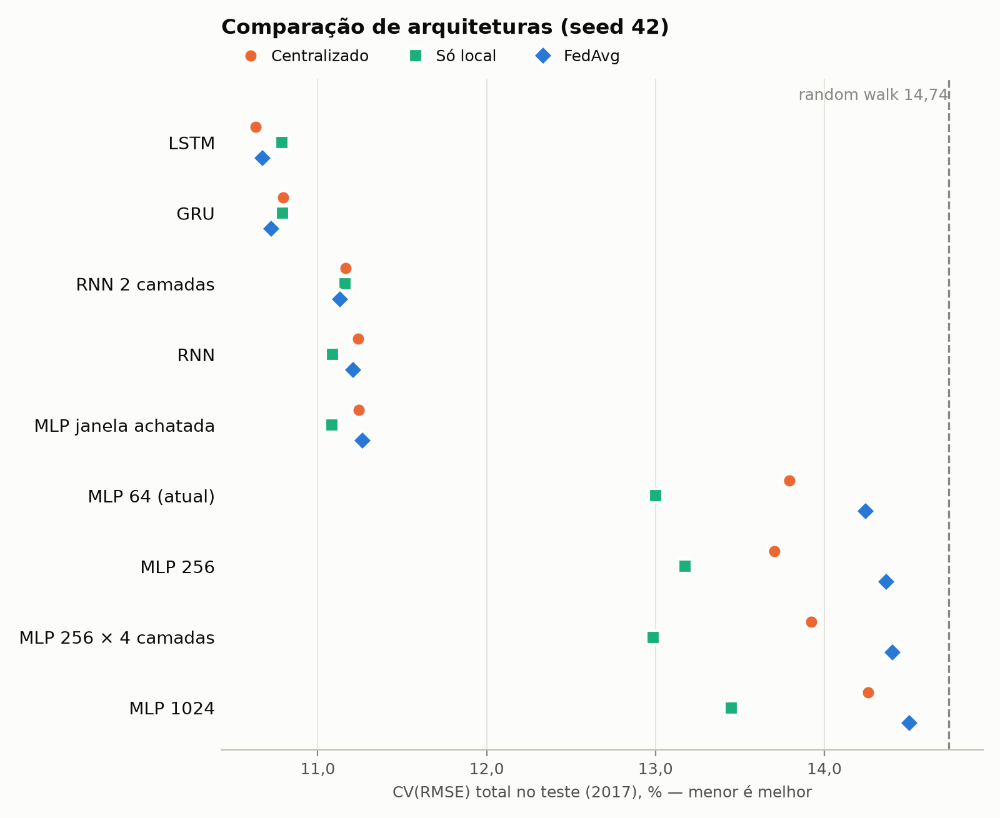
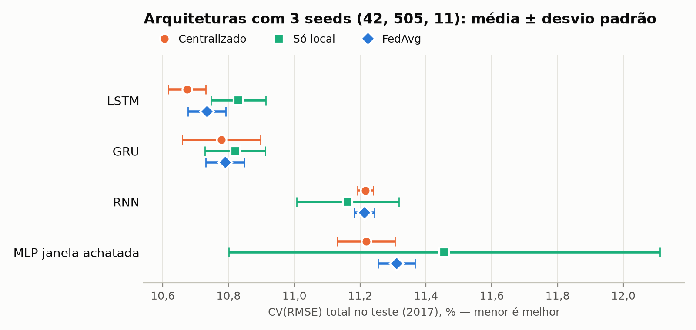
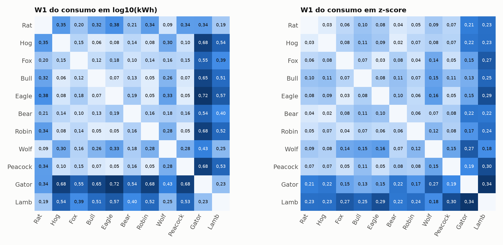
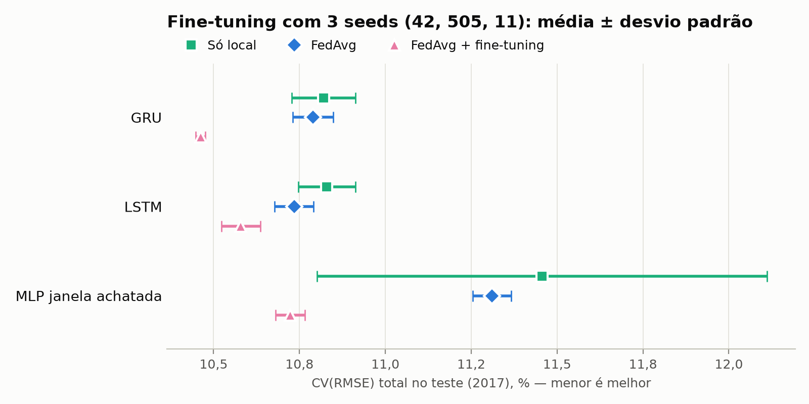
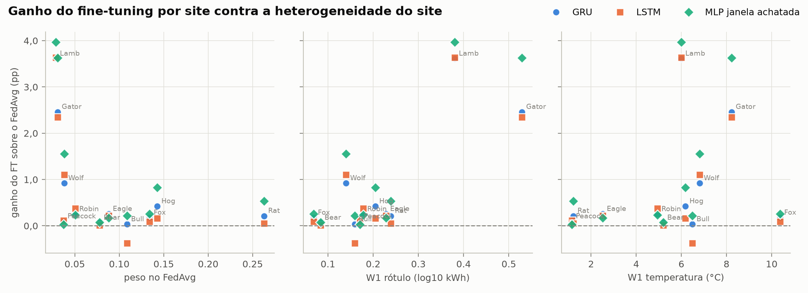
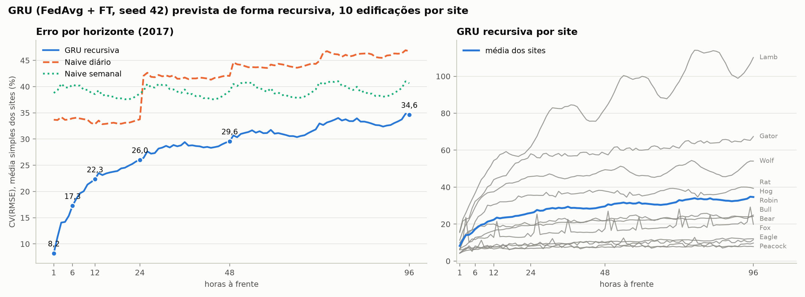

# Arquiteturas de fusão de dados multisensor com aprendizado federado em redes de sensores sem fio
## Introdução

Todos os testes a partir de agora serão feitos com um dataset mais completo, que utiliza todos os 11 sites que passam nas regras, e todos os edifícios de cada site, contra 6 sites e 20 edifícios por site.

> Ambiente de execução:
> Todo o treino da comparação de arquiteturas, do FedAvg com fine-tuning e do fine-tuning por site rodou em GPU (CUDA, Tesla T4 do Google Colab). Os pesos usados nas demais análises saíram desses treinos.
> As exceções são as baselines de Tang et al. (2023) e da FedRSA, em que o fine-tuning nas edificações das baselines rodou na CPU de um MacBook Air M4. As comparações com Ameh et al. (2026) e o teste de horizonte fazem só inferência com os pesos treinados em GPU.

Inicialmente, irei comparar arquiteturas recorrentes contra a MLP original, a ideia veio de uma conversa com um colega egresso do curso que estudou aprendizado federado na residência.

> Observação:
> No experimento da Semana 9, a MLP testado utilizava apenas os lags t-1, t-24 e t-168, as outras das features em t-1 e o seno e cosseno da hora e semana atuais,
> em um teste inicial com os modelos recorrentes, todos eles foram superiores à MLP original.
> Porém os modelos recorrentes todos recebiam como entrada as últimas 24 horas, uma sequência de 24 vetores de tamanho 17.
> Nesse sentido, fiz também uma variação dele, para que na comparação recebesse os mesmos dados que os modelos recorrentes, a entrada
> passou a ser, uma janela completa de 24 horas, ou seja, a hora t passa a ter `17 * 24 = 408` features, com as 24 horas achatadas, passando de
> 17 features para 408 features na camada de entrada, o experimento a seguir foi feito comparando também a MLP original com menos features.

Os modelos testados foram:
LSTM, GRU, RNN, RNN com 2 camadas, MLP com janela de 24h achatada, MLP com largura 64, 256, 1024 e MLP com largura 256 e 4 camadas ocultas.

## Comparação de arquiteturas de redes neurais
Os resultados foram os seguintes:

| modelo | parâmetros | centralizado | só local | FedAvg |
| :-- | --: | --: | --: | --: |
| LSTM | 21.313 | **10,63** | **10,79** | **10,67** |
| GRU | 16.001 | 10,80 | **10,79** | 10,72 |
| RNN 2 camadas | 13.697 | 11,16 | 11,16 | 11,13 |
| RNN | 5.377 | 11,24 | 11,09 | 11,21 |
| MLP janela achatada | 30.401 | 11,24 | 11,08 | 11,26 |
| MLP 64 (atual) | 5.377 | 13,79 | 13,00 | 14,24 |
| MLP 256 | 70.657 | 13,70 | 13,17 | 14,37 |
| MLP 256 × 4 camadas | 202.241 | 13,92 | 12,99 | 14,40 |
| MLP 1024 | 1.069.057 | 14,26 | 13,45 | 14,50 |
| Random walk | — | — | — | 14,74 |

O modelo centralizado só foi superior na LSTM, e, com exceção dela e da RNN com 1 camada, o FedAvg foi superior nas redes recorentes.
Em todas as variações da MLP o modelo só local venceu, e a MLP com a janela achatada foi a melhor.
Aumentar a largura na MLP original não melhorou o resultado, e adicionar camadas teve um aumento pequeno, que pode estar dentro da margem de erro.
Na média, as recorrentes erram cerca de 2,87 pp a menos que as MLPs sem janela (−20,7%) e só 0,25 pp a menos que a MLP janela achatada (−2,2%).
Entre as 5 melhores redes (as 4 recorrentes e a MLP janela achatada), a diferença média é de só 0,21 a 0,33 pp, por esse motivo, escolhi algumas delas para fazer um teste com mais seeds, para validar o quanto a diferença caiu na margem de erro. O critério envolveu o resultado e a quantidade de parâmetros, por ter tido resultado semelhantes à RNN e mais do que o dobro de parâmetros, a RNN com 2 camadas ficou de fora.
As redes testadas com mais seeds foram essas: LSTM, GRU, RNN e MLP com janela achatada.
Resultados:

| modelo | parâmetros | centralizado | só local | FedAvg |
| :-- | --: | --: | --: | --: |
| LSTM | 21.313 | **10,67 ± 0,06** | 10,83 ± 0,08 | **10,73 ± 0,06** |
| GRU | 16.001 | 10,78 ± 0,12 | **10,82 ± 0,09** | 10,79 ± 0,06 |
| RNN | 5.377 | 11,22 ± 0,02 | 11,16 ± 0,16 | 11,21 ± 0,03 |
| MLP janela achatada | 30.401 | 11,22 ± 0,09 | 11,46 ± 0,65 | 11,31 ± 0,06 |
| Random walk | — | — | — | 14,74 |

Com 3 seeds, a margem de erro aparece, e fica possível escolher melhor quais arquiteturas se sobressaem: LSTM e GRU. Juntas, elas erram em média 0,49 pp a menos que a RNN e a MLP janela achatada, uma redução de 4,4% no erro. Sendo assim, para o teste seguinte, irei utilizar a LSTM e a GRU.

## Análise de Heterogeneidade
Antes de seguir no experimento, fiz uma análise da heterogeneidade dos clientes para que seja possível medir o impacto do fine-tuning por site que será aplicado.
A análise segue três dos tipos de dado não IID de Kairouz et al. (2021, seção 3.1), sempre sobre o treino (2016).

**Métricas usadas**

- **Peso no FedAvg.** Fração das amostras de treino de cada site, que é o peso dele na média do FedAvg.
- **Índice de Gini.** Concentração das amostras entre os sites: 0 se todos têm a mesma quantidade; com 11 sites, o máximo é cerca de 0,91, quando um site tem tudo.
- **Escalas.** O consumo é visto em log10 kWh (escala física) e em z-score por edificação (o que o modelo recebe). No z-score sobra só a diferença de forma da distribuição.
- **Wasserstein-1 (W1).** Distância entre duas distribuições, na unidade da variável: a média da diferença entre os quantis de mesmo nível (999 níveis, de 0,001 a 0,999). Cada site é comparado com a união dos outros 10.
- **Assimetria.** 0 numa distribuição simétrica, positiva quando há picos de consumo acima do padrão.

**Tipos de heterogeneidade analisados**: (Kairouz et al., 2021, seção 3.1)
- **Quantidade (quantity skew).** O Rat tem 247 edificações e 26% do peso no FedAvg; o Lamb tem 27 e 2,9%. A razão entre o maior e o menor número de amostras é de 9,2 vezes, e o índice de Gini das amostras é 0,38.
- **Rótulo (label distribution skew, P(y)).** A mediana do consumo médio das edificações vai de 20 kWh no Gator a 110 kWh no Bull. Depois do z-score por edificação, que é o que o modelo recebe, sobra diferença de forma: a W1 contra o resto fica entre 0,03 e 0,09 na maioria dos sites, e sobe para 0,11 no Wolf, 0,19 no Gator e 0,25 no Lamb. O Lamb também é o mais assimétrico (assimetria de 1,40).
- **Entradas (feature distribution skew, P(x)).** A temperatura média vai de 9,8 °C no Wolf a 24,9 °C no Fox, mas depois do z-score por site a W1 fica abaixo de 0,15 em todos. Os medidores opcionais mudam mais de um site para outro: Rat, Bear e Gator não têm nenhum, e gás só aparece no Wolf e no Lamb.

Os sites mais diferentes do resto no rótulo (Lamb, Gator e Wolf) são também três dos quatro menores, então pesam pouco no FedAvg.

## Fine-tuning
Fine-tuning com os hiperparâmetros reotimizados para cada modelo (FedAvg + fine-tuning), comparado com o FedAvg e o só local, no teste de 2017 com 3 seeds (42, 505, 11):

| modelo | FedAvg | só local | FedAvg + fine-tuning |
| :-- | --: | --: | --: |
| GRU | 10,79 ± 0,06 | **10,82 ± 0,09** | **10,46 ± 0,01** |
| LSTM | **10,73 ± 0,06** | 10,83 ± 0,08 | 10,58 ± 0,06 |
| MLP janela achatada | 11,31 ± 0,06 | 11,46 ± 0,65 | 10,72 ± 0,04 |

O CV(RMSE) total junta todas as horas de todos os sites num RMSE só, em kWh, e por isso é ponderado: cada site pesa pela fração de amostras vezes o quadrado do seu consumo médio relativo à média global. Hog fica com cerca de 30% do total, e Lamb, Gator e Wolf, os sites mais heterogêneos, somam menos de 3%.
Para escolher o modelo, a métrica passa a ser a média simples dos CV(RMSE) por site, em que cada cliente tem o mesmo peso:

| modelo | FedAvg | só local | FedAvg + fine-tuning |
| :-- | --: | --: | --: |
| GRU | **10,45 ± 0,06** | **10,37 ± 0,16** | **9,68 ± 0,02** |
| LSTM | 10,50 ± 0,11 | 10,49 ± 0,22 | 9,79 ± 0,06 |
| MLP janela achatada | 10,92 ± 0,08 | 10,59 ± 0,42 | 9,88 ± 0,09 |

Olhando site a site, o fine-tuning da GRU melhora os 11 sites em relação ao FedAvg e ao só local; na LSTM melhora 10 (piora 0,38 pp no Bull). Se o fine-tuning não fizesse diferença, cada site teria metade da chance de melhorar, e a chance de os 11 melhorarem por acaso seria de cerca de 0,001 (teste do sinal, bilateral). Os maiores ganhos sobre o FedAvg estão nos sites heterogêneos: −3,61 pp no Lamb, −2,46 no Gator e −0,92 no Wolf. No Gator e no Wolf o FedAvg era pior que o só local (+2,13 e +0,69 pp), e o fine-tuning recupera essa perda. Com isso, o desvio entre sites cai de 4,77 para 3,87 pp.

Na figura, cada ponto é um site: o eixo vertical é a diferença de CV(RMSE) entre o fine-tuning e o FedAvg (mais negativo, maior o ganho), e cada painel usa uma medida de heterogeneidade do site no eixo horizontal.

Escolhi a GRU: tem a menor média simples dos sites (9,68 ± 0,02), o menor desvio entre seeds, melhora todos os sites com o fine-tuning e tem 25% menos parâmetros que a LSTM.

### Otimização de hiperparâmetros do fine-tuning por site
Com a GRU, testei o fine-tuning com hiperparâmetros otimizados por site: cada cliente roda o Optuna na própria validação (novembro e dezembro de 2016) para escolher a rodada base, a taxa de aprendizado, as camadas ajustadas e o número de épocas. Na validação, a escolha por site ganha da configuração uniforme em todos os 11 sites (−0,23 pp em média, até −1,04 no Gator). No teste de 2017, com 3 seeds, ela perde:

| fine-tuning | média simples dos sites | total |
| :-- | --: | --: |
| uniforme | **9,68 ± 0,02** | **10,46 ± 0,01** |
| por site | 9,78 ± 0,05 | 10,67 ± 0,04 |

As piores perdas estão no Gator (+0,60 pp), Hog (+0,35), Rat (+0,30) e Robin (+0,23); só Lamb (−0,26) e Wolf (−0,13) ganham. A configuração por site se ajusta aos dois meses de validação e não generaliza para 2017. Descartei a otimização por site: o servidor define a configuração de fine-tuning e a envia para todos os clientes.

## Comparação com outros trabalhos

### Comparação com Ameh et al. (2026)
A GRU do FedAvg nos 11 sites, treinada em 2016, foi usada sem nenhum retreino. O protocolo foi reproduzido a partir do código publicado pelos autores (Zenodo 10.5281/zenodo.20527682): as 50 primeiras edificações de escritório ou educação do metadata com pelo menos 80% de leituras, divisão cronológica 70/15/15 sobre 2016–2017, 1 h à frente, e MSE na escala do z-score global do alvo. Apesar de o artigo falar em 50 edificações do Panther, a regra do código seleciona 46 do Panther e 4 do Robin. O Panther não está entre os 11 sites, então nele a previsão é zero-shot.

| parte | método | MSE (escala global) | CV(RMSE) |
| :-- | :-- | --: | --: |
| teste | Ameh: isolado | 0,0067 | — |
| teste | Ameh: centralizado | 0,0102 | — |
| teste | Persistência (t−1) | 0,0075 | 14,0% |
| teste | **GRU FedAvg 11 sites** | **0,0032 ± 0,0002** | **9,4%** |
| val | Ameh: FedAvg sem DP | 1,049 | — |
| val | Ameh: melhor federado (FedProx, ε=0,5) | 0,661 | — |
| val | Persistência (t−1) | 0,0052 | 12,2% |
| val | **GRU FedAvg 11 sites** | **0,0026 ± 0,0001** | **8,1%** |

A GRU sem retreino erra menos da metade do melhor resultado deles (isolado), e bate a persistência em 44 das 50 edificações. Os modelos federados deles foram avaliados na validação, e por isso a tabela mostra as duas partes. Vale notar que o modelo deles recebe só 2 h de consumo, calendário e área, enquanto a GRU usa a janela de 24 h com lags de 24 h e 168 h, clima e outros medidores.

### Comparação com Tang et al. (2023)
No BDG2, a única localização na Flórida é o site Panther, que não está entre os 11 sites, então toda edificação é nova para a GRU. Segui o protocolo do artigo: edificações de escritório, sala de aula ou pesquisa sem buraco de mais de 48 h, entre 15/07 e 12/09/2016, com 30 dias de treino, 10 de validação e 20 de teste, 1 h à frente, e CV = RMSE/média por edificação. O artigo não publica a lista das 30 edificações usadas; aqui entram todas as 52 que passam no filtro. A normalização usa só os 30 dias de treino de cada edificação.

| método | CV (fração) |
| :-- | --: |
| Tang: proposto, nas 26 participantes | 0,0694 |
| Tang: centralizado, nas participantes | 0,0994 |
| Tang: local, nas participantes | 0,1121 |
| Tang: proposto, nas 4 não participantes | 0,1152 |
| Tang: local, nas não participantes | 0,1593 |
| Persistência (t−1) | 0,1072 |
| **GRU zero-shot** | **0,0716 ± 0,0001** |
| GRU + FT uniforme (30 dias) | 0,0707 ± 0,0001 |
| GRU + FT com parada pela validação | 0,0695 ± 0,0002 |

Sem nenhum ajuste, a GRU erra 38% menos que o método deles nas edificações não participantes, e fica no mesmo nível do que eles conseguem nas participantes. O fine-tuning com os 30 dias melhora pouco (0,0716 para 0,0695) e ganha do zero-shot em 39 das 52 edificações.

### Comparação com a FedRSA (Ryu, 2026)
No BDG2, o artigo usa 7 edificações sorteadas, sem publicar quais nem o período: 5 participam do treino federado, e um escritório e uma residencial ficam de fora como não vistas. As não vistas fazem fine-tuning com K = 5, 7 ou 14 dias e são avaliadas nos 5 dias seguintes, 1 h à frente, em MAPE. Como não dá para reproduzir as edificações, rodei o mesmo desenho em todas as edificações de escritório (41) e residenciais (54) dos sites que a GRU nunca viu (Panther e Cockatoo), com pelo menos 90% de leituras em 2017, em 12 janelas por edificação, começando no dia 1 de cada mês de 2017. A normalização usa só os K dias de cada janela.

MAPE (%) no teste de 5 dias, média das edificações (cada uma com a média das 12 janelas e das 3 seeds):

| uso | método | K=5 | K=7 | K=14 |
| :-- | :-- | --: | --: | --: |
| escritório | Ryu: FedAvg + FT | 15,20 | 14,10 | 12,30 |
| escritório | Ryu: FedRSA | 10,70 | 10,10 | 8,92 |
| escritório | Persistência (t−1) | 8,25 | 8,30 | 8,27 |
| escritório | **GRU zero-shot** | **6,02** | **6,02** | **5,87** |
| escritório | GRU + FT uniforme | 6,01 | 6,00 | 5,85 |
| residencial | Ryu: FedAvg + FT | 16,80 | 15,62 | 13,47 |
| residencial | Ryu: FedRSA | 11,84 | 11,10 | 9,93 |
| residencial | Persistência (t−1) | 6,13 | 6,14 | 6,16 |
| residencial | **GRU zero-shot** | **5,25** | **5,32** | **5,17** |
| residencial | GRU + FT uniforme | 5,24 | 5,30 | 5,15 |

A GRU sem ajuste fica abaixo da FedRSA nos dois tipos de edificação e em todos os K. Como as edificações e o período do artigo não são conhecidos, a comparação é de tendência e não de valor; até a persistência fica abaixo dos números do artigo, o que sugere que as edificações sorteadas por eles são mais difíceis ou que o modelo deles é mais fraco. O fine-tuning uniforme quase não muda o resultado, porque com 120 a 336 amostras e lote de 512 as 32 épocas viram 32 passos com lr de 3e-5. Para K = 5 e 7, o lag de 168 h da GRU usa dados de antes do início da janela, o que o desenho do artigo não prevê.

## Estudo adicional: previsão de várias horas à frente
Teste preliminar de horizonte: a GRU com fine-tuning de cada site (seed 42), treinada só para 1 h à frente, foi usada de forma recursiva até 96 h, sem retreino. A cada hora, a previsão entra como lag de 1 h da hora seguinte; os lags de 24 h e 168 h usam o valor medido quando caem antes da origem e a previsão quando caem depois. O clima é o observado (equivale a uma previsão do tempo perfeita), e os outros medidores ficam congelados no último valor medido. A amostra são 10 edificações sorteadas por site, com origens a cada 23 h ao longo de 2017. As referências são o naive diário (repetir o último dia medido) e o naive semanal (repetir a última semana medida).

| horas à frente | 1 | 6 | 12 | 24 | 48 | 96 |
| :-- | --: | --: | --: | --: | --: | --: |
| GRU recursiva | **8,2** | **17,3** | **22,3** | **26,0** | **29,6** | **34,6** |
| naive diário | 33,7 | 34,0 | 32,8 | 33,8 | 42,0 | 46,7 |
| naive semanal | 38,8 | 40,4 | 38,6 | 38,7 | 39,2 | 40,6 |

CV(RMSE) em %, média simples dos sites.

A GRU fica abaixo das duas referências em todos os horizontes, mesmo sem ter sido treinada para isso. O erro cresce rápido nas primeiras 12 h e depois mais devagar. A média é puxada por poucos sites: em 96 h, Peacock, Eagle, Fox e Bear ficam entre 7,8% e 12,1%, enquanto Wolf, Gator e Lamb chegam a 54%, 67% e 110%. Pelos exemplos, os erros grandes vêm de edificações atípicas: consumo quase zero ou plano, em que a previsão chega a ficar negativa (Lamb_education_Mae, Robin_lodging_Phillip), e mudanças de patamar no meio da série (Rat_public_Toya, Bull_lodging_Lettie). É uma amostra pequena, com uma seed só. 

## Limitações

- **Escolha da arquitetura.** LSTM e GRU foram escolhidas olhando o CV(RMSE) de 2017, que também é o teste. O número final pode estar um pouco otimista; as diferenças entre arquiteturas foram de décimos, então o efeito deve ser pequeno. O fine-tuning e o fine-tuning por site foram ajustados na validação de novembro e dezembro de 2016, sem esse problema.
- **Baselines.** Tang et al. não publicam a lista de edificações, e a FedRSA não publica nem as edificações nem o período. Nos dois casos, a comparação reproduz o protocolo, mas não os mesmos dados; com a FedRSA, é de tendência, não de valor.
- **WSN.** Os dados do BDG2 são tratados como se viessem de nós de uma WSN, mas não foram coletados por uma.
- **Horizonte.** O teste de várias horas à frente é preliminar: uma seed, 10 edificações por site.

## Conclusão

Nos 11 sites do BDG2, a GRU com FedAvg e fine-tuning local foi o melhor modelo, com 9,68 ± 0,02 de CV(RMSE) na média simples dos sites em 2017, contra 10,45 do FedAvg e 10,37 do só local. O fine-tuning melhorou todos os 11 sites, com os maiores ganhos nos sites mais diferentes do resto (Lamb, Gator e Wolf), em que o FedAvg sozinho ficava pior que o treino local. Otimizar a configuração do fine-tuning por site levou a overfitting na validação, então a configuração fica definida pelo servidor e é a mesma para todos os clientes.

Sem retreino, a mesma GRU ficou à frente das três baselines de FL com dados do BDG2 (Ameh et al., Tang et al. e FedRSA), inclusive em edificações de sites que não participaram do treino. Usada de forma recursiva, também ficou abaixo das previsões ingênuas até 96 h à frente, sem ter sido treinada para isso.
